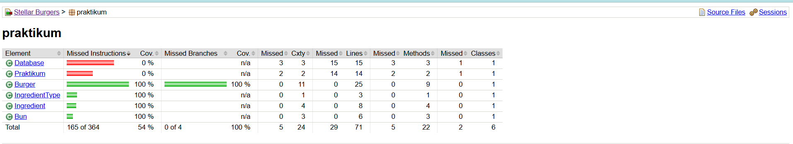

# 🍔 Stellar Burgers — юнит-тесты


Дипломный проект по автоматизации тестирования: **97 юнит-тестов** и **100% покрытие**
бизнес-логики приложения заказа бургеров Stellar Burgers. Порог покрытия закреплён
в сборке — `mvn verify` падает, если покрытие `Burger`, `Bun`, `Ingredient` или
`IngredientType` опустится ниже 100%.

---

## 📑 Содержание

- [О проекте](#-о-проекте)
- [Что проверяется](#-что-проверяется)
- [Стек технологий](#-стек-технологий)
- [Структура проекта](#-структура-проекта)
- [Тесты (97)](#-тесты-97)
- [Покрытие JaCoCo](#-покрытие-jacoco)
- [Запуск](#-запуск)
- [Особенности реализации](#-особенности-реализации)

---

## 📋 О проекте

Программа помогает заказать бургер в Stellar Burgers. Состоит из шести классов:

| Класс | Назначение | Покрыт тестами |
|---|---|---|
| **Burger** | Модель бургера: булочка и список ингредиентов | ✅ 100% |
| **Bun** | Модель булочки (название + цена) | ✅ 100% |
| **Ingredient** | Модель ингредиента (тип + название + цена) | ✅ 100% |
| **IngredientType** | Enum типов ингредиентов: `SAUCE`, `FILLING` | ✅ 100% |
| **Database** | Статический справочник булочек и ингредиентов | ⛔ инфраструктура |
| **Praktikum** | Точка входа в приложение (`main`) | ⛔ инфраструктура |

`Database` и `Praktikum` не тестируются осознанно: это справочные данные и запуск
приложения, бизнес-логики в них нет. Они же исключены из проверки покрытия.

---

## 🧪 Что проверяется

### `Burger`

| Метод | Что проверяют тесты |
|---|---|
| `setBuns(Bun)` | Булочка устанавливается и возвращается через `getBun()` |
| `addIngredient(Ingredient)` | Ингредиент добавляется в конец списка, размер растёт |
| `removeIngredient(int)` | Удаляется именно нужный ингредиент, размер уменьшается; на невалидном индексе — исключение, список не меняется |
| `moveIngredient(int, int)` | Перестановка ингредиентов (21 сценарий); на невалидных индексах — исключение, порядок не меняется |
| `getPrice()` | Цена = булочка + ингредиенты; пустой бургер = `0`; бургер только с булочкой = цена булочки |
| `getReceipt()` | Рецепт: название булочки сверху и снизу, ингредиенты в середине, метка `Price` и итоговая сумма |

### `Bun` и `Ingredient`

- Геттеры `getName()`, `getPrice()`, `getType()` на параметризованных наборах данных
- Разные типы ингредиентов (`SAUCE`, `FILLING`)
- Граничные случаи: пустые названия, нулевые цены

---

## 📦 Стек технологий

| Технология | Версия | Назначение |
|---|---|---|
| ☕ **Java** | 11 | Язык программирования |
| 🏗 **Maven** | 3.6+ | Сборка и управление зависимостями |
| ✅ **JUnit 4** | 4.13.2 | Фреймворк для тестирования |
| 🎭 **Mockito** | 4.11.0 | Мокирование объектов |
| 🔍 **Hamcrest** | 2.2 | Матчеры для проверок (в том числе в `ErrorCollector`) |
| 📊 **JaCoCo** | 0.8.15 | Анализ покрытия кода и quality gate |

---

## 📁 Структура проекта

```text
.
├── src/
│   ├── main/java/praktikum/
│   │   ├── Burger.java                 — модель бургера
│   │   ├── Bun.java                    — модель булочки
│   │   ├── Ingredient.java             — модель ингредиента
│   │   ├── IngredientType.java         — enum: SAUCE, FILLING
│   │   ├── Database.java               — справочник булочек и ингредиентов
│   │   └── Praktikum.java              — точка входа
│   └── test/java/praktikum/
│       ├── BurgerTest.java             — 15 тестов
│       ├── BurgerPriceParameterizedTest.java    — 6 тестов
│       ├── BurgerRemovePositiveTest.java        — 6 тестов
│       ├── BurgerRemoveNegativeTest.java        — 8 тестов
│       ├── BurgerMovePositiveTest.java          — 21 тест
│       ├── BurgerMoveNegativeTest.java          — 5 тестов
│       ├── BunTest.java                — 8 тестов
│       └── IngredientTest.java         — 28 тестов
├── docs/
│   └── jacoco-report.png               — скриншот отчёта покрытия
└── pom.xml
```

---

## ✅ Тесты (97)

**30 тест-методов** после параметризации дают **97 запусков**, все проходят.

| Класс | Методов | Запусков | Что покрывает |
|---|---:|---:|---|
| `BurgerTest` | 15 | 15 | Основные методы `Burger` |
| `BurgerPriceParameterizedTest` | 1 | 6 | Расчёт цены: булочка + ингредиенты, пустой бургер, только булочка |
| `BurgerRemovePositiveTest` | 2 | 6 | Удаление ингредиентов по валидным индексам |
| `BurgerRemoveNegativeTest` | 2 | 8 | Невалидные индексы удаления |
| `BurgerMovePositiveTest` | 3 | 21 | Перемещение ингредиентов между позициями |
| `BurgerMoveNegativeTest` | 1 | 5 | Невалидные индексы перемещения |
| `BunTest` | 2 | 8 | Параметризованные проверки булочек |
| `IngredientTest` | 4 | 28 | Параметризованные проверки ингредиентов |
| **Итого** | **30** | **97** | |

---

## 📊 Покрытие JaCoCo

| Класс | Строки | Инструкции | Ветки |
|---|---|---|---|
| `Burger` | 25 / 25 — **100%** | 139 | 4 / 4 — **100%** |
| `Bun` | 6 / 6 — **100%** | 15 | — |
| `Ingredient` | 8 / 8 — **100%** | 21 | — |
| `IngredientType` | 3 / 3 — **100%** | 24 | — |

**Quality gate.** В `pom.xml` настроено правило JaCoCo: для этих четырёх классов
`LINE` и `BRANCH` должны быть покрыты на `1.00`. Если покрытие просядет, `mvn verify`
завершится ошибкой — регрессия в тестах не пройдёт незамеченной.



*Отчёт JaCoCo: 100% по всем бизнес-классам (изображение: `docs/jacoco-report.png`)*

---

## 🚀 Запуск

### Требования

- **Java 11+** — [скачать](https://adoptium.net/)
- **Maven 3.6+** — [скачать](https://maven.apache.org/download.cgi)

Проверить окружение:

```bash
java -version
mvn -version
```

### Запустить все тесты

```bash
mvn clean test
```

### Запустить конкретный тест

```bash
mvn test -Dtest=BurgerTest
mvn test -Dtest=BurgerTest#setBunsShouldSetBun
mvn test -Dtest=BurgerPriceParameterizedTest
```

### Прогнать тесты и проверить покрытие

```bash
mvn clean verify
```

Отчёт будет доступен в `target/site/jacoco/index.html`, а сборка упадёт, если
покрытие опустится ниже 100%.

---

## 💡 Особенности реализации

### Параметризованные тесты

Используется `@RunWith(Parameterized.class)` — один тест-метод проверяет сразу
набор сценариев:

- разные типы ингредиентов (`SAUCE`, `FILLING`);
- разные цены булочек и ингредиентов;
- граничные случаи: пустые значения, нулевые цены.

### Мокирование с Mockito

`@Mock` и `MockitoAnnotations.openMocks()` позволяют изолировать тесты от
внешних зависимостей, проверять взаимодействие объектов (`verify`) и управлять
поведением зависимостей (`when`).

### ErrorCollector для множественных проверок

Там, где нужно проверить несколько условий сразу (например, размер списка и его
содержимое), используется `ErrorCollector` из JUnit 4:

```java
@Rule
public ErrorCollector errorCollector = new ErrorCollector();

@Test
public void exampleTest() {
    errorCollector.checkThat("First check", actualValue1, is(expectedValue1));
    errorCollector.checkThat("Second check", actualValue2, is(expectedValue2));
}
```

**Преимущества:**

- все проверки выполняются, даже если первая упала — виден весь список ошибок;
- соответствует принципу «один тест — одна логическая проверка».

### Негативные тесты

Явная проверка исключений (`@Test(expected = ...)`) для:

- невалидных индексов при удалении ингредиентов;
- невалидных индексов при перемещении ингредиентов;
- проверки, что список не меняется при ошибке.

---

## 📈 Результаты

- ✅ Все **97** тестов проходят
- ✅ **100%** покрытие бизнес-классов (`Burger`, `Bun`, `Ingredient`, `IngredientType`)
- ✅ Покрытие закреплено quality gate в `pom.xml`
- ✅ Нет дублирования кода в тестах
- ✅ Используются best practices JUnit 4 и Mockito

---

## 👤 Автор

**Valery Belyayeva**

<div align="center">

*Дипломный проект Яндекс.Практикума по QA-автоматизации*

Java 11 · JUnit 4 · Mockito · JaCoCo

</div>
